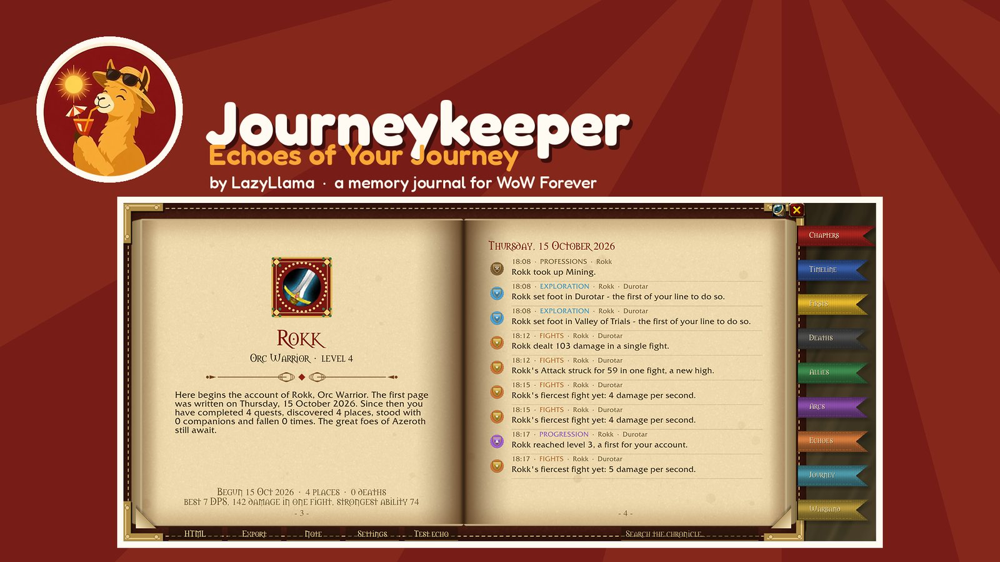
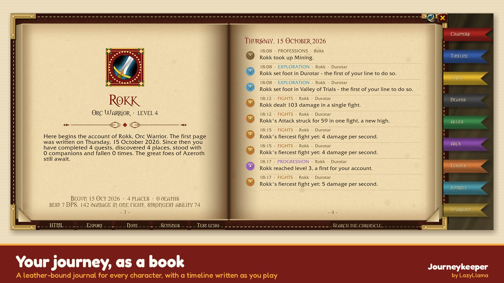
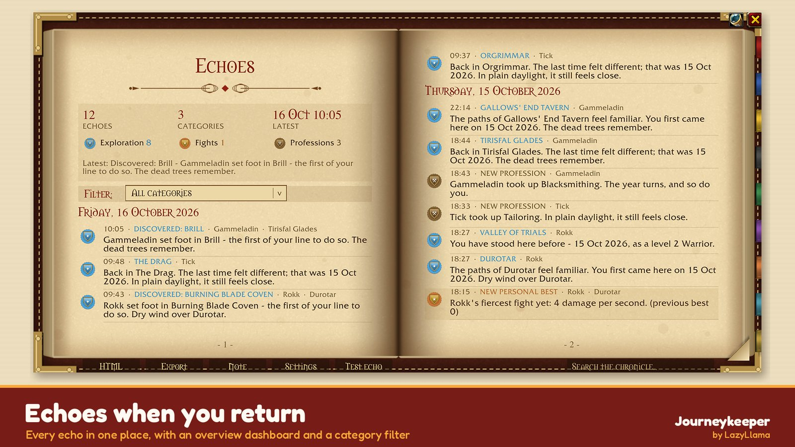
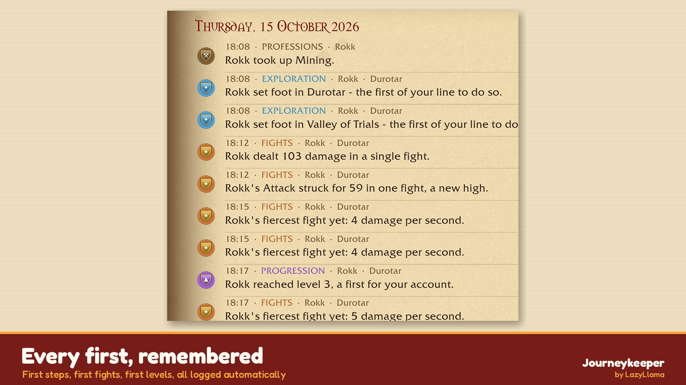
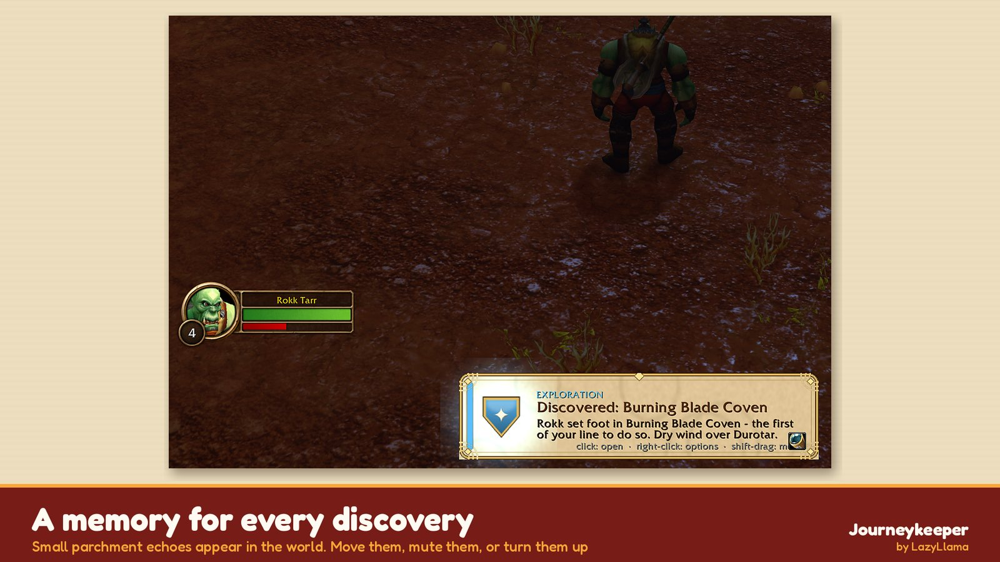
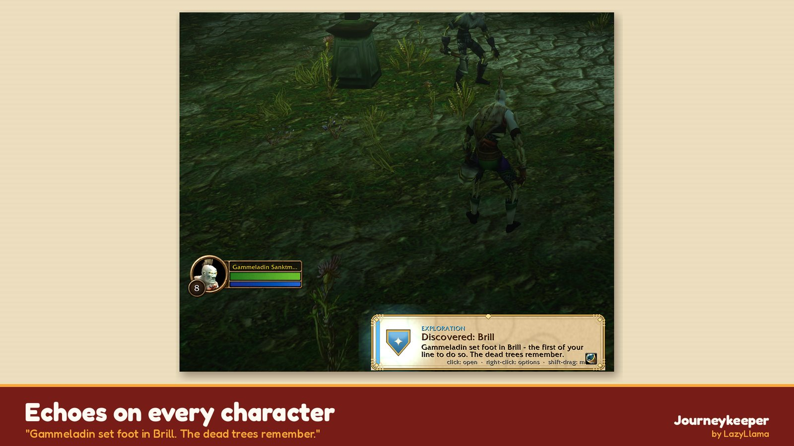
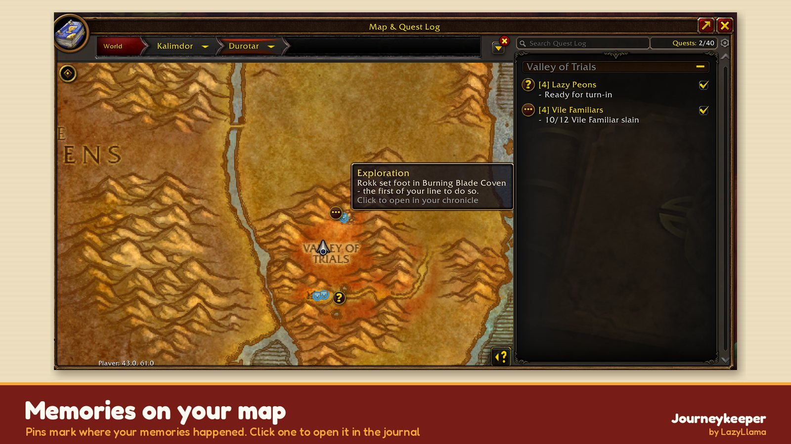
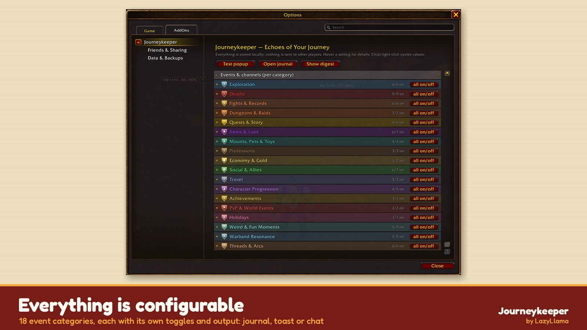
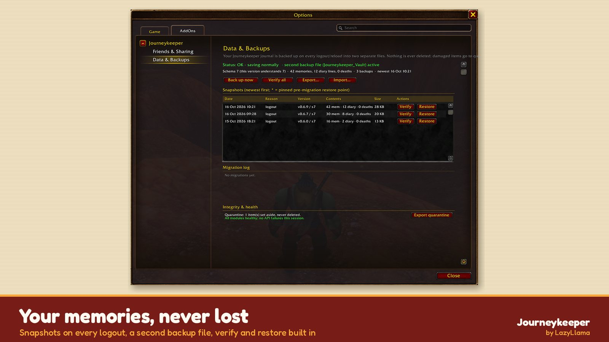

# Journeykeeper — Echoes of Your Journey

> Formerly developed under the working name "Chronicle". Slash commands: `/jkp` and `/journeykeeper`.
> (`/jk` is not used: it is a built-in Blizzard emote, "joke".)

A WoW Forever beta (Interface 16001, Mainline API) addon written in plain Lua with no libraries. It records your journey and surfaces "echoes" of it. All data stays local; nothing is sent to other players unless you opt into friend sharing.

## Screenshots

| | |
|---|---|
|  The journal book |  Echoes page with filters |
|  Timeline of your firsts |  Echo toast in Durotar |
|  Echo toast in Brill |  Echoes on the world map |
|  Settings categories |  Data & Backups |

## Commands (v0.3)
`/jkp` opens the journal. `/jkp config` opens the settings, `/jkp export` opens a plain-text export, `/jkp note <text>` adds a note to your target (or your most recent ally), `/jkp test` shows a test toast, `/jkp unmute` clears every memory you muted, and `/jkp debug` prints echo scores. New in v0.3: `/jkp html` (HTML book of the weightiest memories, in a copyable box), `/jkp pin [#]` (pins the last echoed memory, or entry #), `/jkp arc new <name>` | `add [#]` | `use <n>` | `arc` (list), `/jkp diary`, `/jkp digest`.

## Layout
Registry.lua (generated event registry) · Core · Templates · Toast · Echoes · Logger · Tooltip · Journal · Settings · MapPins · media/*.tga (uncompressed 32-bit BGRA, top-left origin)

The event list is documented in docs/EVENT_CATALOG.md.

## Installing from source
1. Copy (or junction/symlink) the `Journeykeeper` and `Journeykeeper_Vault` folders into `World of Warcraft\_classic_beta_\Interface\AddOns\`.
2. `docs/` is harmless inside AddOns (the game ignores it), but release zips leave it out.

## Echo engine
Each echo gets a score: a category weight (deaths and dungeons 3; allies, levels, loot and achievements 2; zones 1), plus 2 for a first, 3 for an anniversary, 2 for an absence of 30+ days and 1 for shared history (3 or more), minus 3 if that memory was shown in the last day or 1 if in the last week. Forced events get +5.
Intensity levels: silent (no echoes); soft (score 5+, at most one every 3 min); present (3+, one every 30 s); storyteller (1+, one every 8 s).
Echoes are held back in combat and, if you choose, inside instances (up to 5 wait); they are shown once you leave combat or change zone. To use the `echoes` channel, create a chat window named "Echoes"; otherwise those lines go to the main chat window.

## v0.3 features (every one can be switched off or tuned in Settings; see docs/SETTINGS.md)
- **Adaptive weighting** (Weight.lua): a memory's weight = category base + rarity across the account + context (e.g. you died here long ago at a much lower level) + pin boost + reinforcement each time it is echoed or revisited − slow fading of ordinary memories + "remind me more" category boosts + your ally rating.
- **Warband resonance**: echoes that name your other character, their class and level ("Your Zentala once hunted here..."); warband "family firsts" for rares, bosses and instance clears; an optional ghost trail of your other characters on the world map (sampled positions outside instances, at most 400 dots per map, one colour per character). The map legend in the preview is mock-only.
- **Soft social**: tooltip lines (times grouped, shared runs, last seen, your rating, your notes); a private Great / Forgettable / Avoid / Skip prompt when a group ends. Nothing is sent to other players. Sharing between friends via addon messages is planned but not built.
- **Atmosphere**: a vignette for strong echoes, a minimap icon that pulses when there are new echoes (opens the Echo Diary), ambient sounds (chime/parchment/horn, built-in sound kits with numeric fallbacks), and Quiet Mode.
- **Threads**: chains ("the third time you returned to where you first fell", a homecoming to your first zone after 10+ levels), arcs you create yourself (each gets a chapter in the journal), and a "Since you were last here" digest at login.
- **Agency**: "Never show this memory again", "Remind me more about <category>", an automatic intensity curve (stricter in raids, instances and sessions over 2 h, looser while resting), and an Echo Diary tab.
- **Variety**: templates are grouped into flavour families, and a family used in either of the last two picks for that kind is skipped.

## v0.4

### Combat metrics (Combat.lua)
Data comes from Blizzard's own damage meter API, `C_DamageMeter`. warcraft.wiki.gg lists it for the Forever client.
- **Secret values:** the values are secret during combat. Journeykeeper reads them only after `PLAYER_REGEN_ENABLED` (+1.5 s), and only when `issecretvalue` says they are readable.
- **Records tracked:** best DPS, most damage in one fight, longest fight, best HPS, strongest ability (per-spell fight total), and boss fight stats (on `ENCOUNTER_END` success).
- **No biggest single hit:** the API has no per-hit maximum, and combat-log amounts are secret, so `crit_record` stays blocked.
- **Fallback:** if `C_DamageMeter` is missing or disabled, nothing is recorded. `/jkp records` shows the reason.

Sources:
- https://warcraft.wiki.gg/wiki/API_C_DamageMeter.GetCombatSessionFromType
- https://warcraft.wiki.gg/wiki/API_C_DamageMeter.GetCombatSessionSourceFromType
- https://warcraft.wiki.gg/wiki/Secret_Values
- https://github.com/Gethe/wow-ui-source/blob/live/Interface/AddOns/Blizzard_APIDocumentationGenerated/DamageMeterDocumentation.lua

### Flavor (Flavor.lua)
Adds an optional extra line to echoes. The line comes from one of these sources, in priority order:
1. Holiday, read from `C_Calendar` HOLIDAY events
2. Zone mood
3. Game time of day
4. Real-world season

Each source has its own toggle. There is also a chance slider, and an Era label that appears on the journal title page.

### Friend sharing (Share.lua) - opt-in, OFF by default
How it works:
- Messages use the addon-message prefix `JKPR`, with a HELLO/ack handshake that carries the version.
- Sending goes through a token-bucket queue (800 B/s) with 240-byte chunks. The queue holds while you are in combat.
- Only trusted friends receive messages. You can optionally accept messages from your friends list or guild.
- There is a block list.

What gets sent:
- Only the categories you pick: milestones and firsts.
- Zone is included only when you opt in.
- No public channels and no automatic chat messages.

Incoming messages:
- They appear as gentle `friend_milestone` toasts.
- When a friend's boss, rare or dungeon matches one of your entries from the same day, you get a `shared_echo` instead.

Commands: `/jkp friend add|remove|block|unblock|list Name-Realm`, `/jkp records`.

## v0.4.1 - Friends & Sharing page
A Settings subcategory under Journeykeeper (`/jkp friend page`, implemented in `FriendsPage.lua`).

**Player list.** It lists everyone detected running Journeykeeper, from handshakes and messages:
- Columns: class-coloured Name-Realm, addon version, last seen, source (whisper/party/guild), status badge (Trusted/Known/Blocked) and shared-memory count.
- Click a column header to sort. A search box filters the list, and the list scrolls.
- Row buttons: Trust/Untrust, Block/Unblock, Remove, Ping.

**Trusted friends.** An add-friend field (Name-Realm) with a button, and a list of trusted friends.

**Sharing settings.** All sharing options, grouped into Sharing, What to share, Channels, Accept from and Incoming.

**Data.** Everything is stored in `JourneykeeperDB.share` (trusted, blocked, peers{ver, seen, src, class, shared}). This is the same data the `/jkp friend add|remove|block|unblock|ping` commands use.

**Handshake.** HELLO now carries your class.
- A party HELLO from a stranger is listed as "Known", but gets no reply and no milestone data.
- A milestone that arrives twice (via whisper and party/guild) is handled once.

## v0.5 - Data safety
See `docs/DATA_SAFETY.md`.

**What's new:**
- Schema versioning, with migrations that never delete anything and run on a copy, plus rollback.
- Load guards: a malformed save, a missing save with backups present, or a newer schema all switch to read-only.
- Validation, with a quarantine for damaged data.
- Two rotating backup rings. The second ring is in the companion addon **Journeykeeper_Vault**, so it lives in a separate SavedVariables file.
- A Data & Backups Settings page (`/jkp data`) with verify and restore.
- Full export and merge-import (`/jkp exportall`, `/jkp import`), with stable entry ids.
- Handler isolation and patch detection, so one failing module does not break the rest.
- A manual snapshot at any time with `/jkp backup`.

**Sync:** Journeykeeper_Vault must be its own folder in `Interface\AddOns`. Junction or copy `Journeykeeper\Journeykeeper_Vault` next to `Journeykeeper`.

## v0.5.1 - Performance
See `docs/PERFORMANCE.md`. Measure in-game with `/jkp perf`.

**Changes:**
- The combat log listener is now opt-in.
- Zone handling uses an incremental death index instead of scanning every entry.
- The sharing queue runs only while messages are queued.
- Settings pages are built on first open.
- Snapshots are smaller and fewer: caches excluded, shortest float format, 2 per file, a new ring snapshot at most every 6 h, a size cap, and skipped when nothing changed.

## v0.6 - Six new chapters
Every module is its own file with its own Settings section and master switch. All of them follow the data-safety layer (schema 7, additive migration, stable uids, included in snapshots and export/import) and the performance rules (UI built lazily, no per-frame idle work).

| Module | File | Default | What it does |
|---|---|---|---|
| Photo mode | `Photo.lua` | on | `/jkp photo [close/medium/wide]`, a keybind, or the spyglass button on toasts and the journal. Works only out of combat. Hides the UI (`UIParent:Hide`, never in combat), shows a vignette + ornate frame + caption, calls `Screenshot()`, then restores the UI and camera. If combat starts mid-shot, the UI comes back as soon as combat ends. The photo is linked to the memory by uid. The journal shows a placeholder card with the filename (`WoWScrnShot_MMDDYY_HHMMSS.jpg`). |
| Journey map | `Journey.lua` | on | New **Journey** tab: each character's road (zones in first-visit order with dates, level-ups, firsts), a continent sketch page (positions from `C_Map.GetMapRectOnMap`), and the photo Album. Optional ink path on the world map, drawn from ghost-trail samples. |
| Death reports | `DeathReport.lua` | on (announce **off**) | A "last moments" card per death: killer, level, zone/subzone, coords, time alive since the last death, last target, falling/drowning, group members present (max 10), plus a death counter. Upgrades the Deaths tab. Optional one-line party/guild announcement: at most once per 5 min, never in combat lockdown or during an encounter. |
| Person profiles | `Profiles.lua` | on | Private TRP3-lite cards: class, race/level when seen, guild, first met, shared runs, rating, tags, notes, Journeykeeper sharing status. Only players you have already met are updated. Commands: `/jkp who [name]`, `/jkp tag <name> <tag>`, `/jkp rate <name> 0-5`. Open with a keybind, or see the tooltip line. Nothing is ever sent. |
| Warband overview | `WarbandTOC.lua` | on | New **Warband** tab, laid out as a table of contents: level, time played, gold, zones, memories, deaths and last played per character. Click a name to open its chapter. Time played is requested only when you click the summary or type `/jkp played`. |
| Book-style dialogue | `Dialogue.lua` | **off** | Adds a "Read in Journeykeeper" button and a parchment that mirrors the quest text. Story (campaign/important) quest texts are saved to the Diary chapter's "Tales" section. Blizzard's quest frame is never hooked, re-parented or scripted, and accept/complete stay on Blizzard's buttons. |

Keybinds (Bindings.xml): Photo mode, Profile of target, Open the journal. New events: `photo_taken`, `quest_story`.

## Community & feedback
- Discord: [discord.gg/EYEuYJxY4U](https://discord.gg/EYEuYJxY4U)
- Bugs & ideas: [GitHub Issues](https://github.com/LazyLlamaDev/Journeykeeper/issues). Please include your addon version and any Lua error (BugSack/BugGrabber help).

## FAQ
**Was AI used?** Yes. Journeykeeper is my idea and design: a journal that keeps memories across your characters and years in WoW Forever. I used AI tools to help write code, text and some artwork. I test every feature in-game myself and decide what ships.

## Upgrading from the "Chronicle" test builds
No public release ever used the old name, so there is no automatic migration. If you have local data from a "Chronicle" test build, keep that old addon enabled for **one** login next to Journeykeeper (it loads first: addons load alphabetically). Journeykeeper then imports `ChronicleDB` once, but only if the data carries this addon's own fingerprint, so data from unrelated addons that use the same name is ignored. The import adds data only, skips duplicates by stable uid, takes a pre-import snapshot, and never changes the old table. Afterwards you can disable or delete the old folder. Old `!CHRONICLE1!` export strings can also still be pasted into `/jkp import`.

## License
All Rights Reserved (see `LICENSE`). Source is published for transparency and personal inspection. Copying, modifying, redistributing, or reuploading without written permission is not allowed. Contact: [github.com/LazyLlamaDev](https://github.com/LazyLlamaDev).
World of Warcraft® and Blizzard Entertainment® are trademarks of Blizzard Entertainment, Inc. This is an independent community addon.
